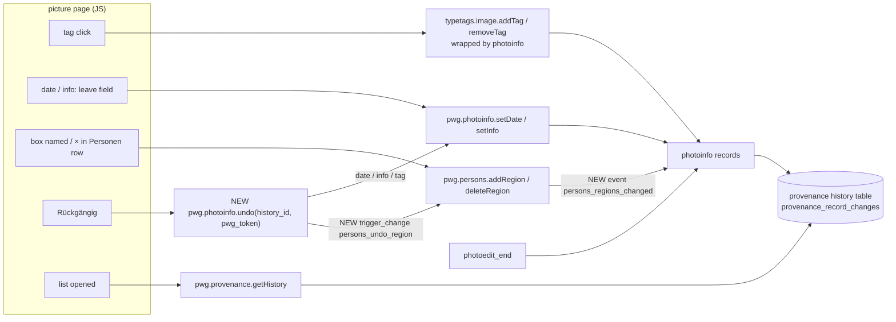

# Picture page: one save model, a shared change list, undo

## Problem

The picture page (example: `https://bilder.foerderverein-sefferweich.de/picture.php?/2230/category/90`)
has four edit features with four save rules:

| Feature | Plugin | How it starts | When it is saved | How it ends |
|---|---|---|---|---|
| Datum | photoinfo | click the text (tooltip only) | Speichern button | page reload |
| Info | photoinfo | click the text | Speichern button | page reload |
| Personen | persons | toggle „Personen markieren“ | at once, per named box; × deletes without confirm | toggle „Markieren beenden“, reload |
| Schlagwörter | typetags | nothing, badges always shown | at once, one click | no feedback |
| Drehen/Zuschneiden | photoedit | toolbar button | full-screen mode + Speichern | reload |

Users are mostly older club members working on scanned family photos. Every write also writes the
image file through exiftool, so even the "instant" ones take time and can fail.

## Sources

- Prototype with all three concepts (A, B, C) and the chosen one, clickable:
  [prototype/picture-edit-concepts.html](prototype/picture-edit-concepts.html), published at
  https://claude.ai/artifact/GAwQasqYbQw96PrUJLesfa (tab „Konzept B“ is the chosen design)
- Research (fetched in full):
  [Primer: Saving](https://primer.style/ui-patterns/saving),
  [NN/g: Modes](https://www.nngroup.com/articles/modes/),
  [NN/g: Confirmation dialogs](https://www.nngroup.com/articles/confirmation-dialog/),
  [NN/g: Usability for older adults](https://www.nngroup.com/articles/usability-for-senior-citizens/),
  [Google Photos: label faces](https://support.google.com/photos/answer/6128838)
- Research (search excerpt only):
  [Oracle Alta save model](https://www.oracle.com/webfolder/ux/middleware/alta/patterns/SaveModel.html),
  [saasui.design autosave](https://www.saasui.design/blog/saas-autosave-save-states-ux-patterns),
  [GNOME HIG dialogs](https://developer.gnome.org/hig/patterns/feedback/dialogs.html),
  [MDN beforeunload](https://developer.mozilla.org/en-US/docs/Web/API/Window/beforeunload_event),
  Flickr help, digiKam, FamilySearch, Apple Photos (links in the prototype)
- Related decisions: [0058](../../../docs/agents/decisions/0058-photoinfo-date-and-info-editable-by-logged-in-users.md)
  (photoinfo editable by all logged-in users, still holds),
  [0059](../../../docs/agents/decisions/0059-photo-edits-are-open-to-every-logged-in-account-that-sees-the-photo.md),
  [0064](../../../docs/agents/decisions/0064-normal-users-read-provenance-and-tag-groups-on-read-only-pages.md),
  [0065](../../../docs/agents/decisions/0065-normal-users-delete-only-the-regions-they-drew.md),
  [0020](../../../docs/agents/decisions/0020-persons-index-is-derived-the-file-is-the-source-of-truth.md),
  [0023](../../../docs/agents/decisions/0023-no-database-transfer-to-the-remote.md)

Research takeaways that shaped the design: one save pattern per page; instant save needs visible
status; undo beats confirm dialogs for reversible changes; face tagging is a bounded action with a
clear end; large targets and errors next to the field for older users.

## Target picture page

```
┌──────────────────────────────┐  DATUM  ✓ Gespeichert · Rückgängig        ✎ ändern
│                              │  ca. 1955
│        photo                 │  INFO                                     ✎ ändern
│   [Anna]   [Peter]           │  Kirmes vor der Gastwirtschaft …
│                              │  PERSONEN
│                              │  Anna Schmitz ×   Peter Hoffmann ×
└──────────────────────────────┘  [+ Person markieren]
                                  SCHLAGWÖRTER  ✓ Gespeichert · Rückgängig
                                  (Seffern ×) (Kirmes ×)   + Kirche  + Hochzeit …
                                  ▸ Letzte Änderungen an diesem Foto (3)
```

Expanded, each list entry reads e.g. „„Kirmes“ hinzugefügt — maria.t · gestern, 18:42 · Rückgängig“.

## Data flow



## Key Decisions

### Save model: Konzept B, every step saves itself, visibly

- **Decision:** Each step is complete on its own and saves at once: a tag click, a date when focus
  leaves the date group, the info text when focus leaves the field, a named box. Each row then shows
  „✓ Gespeichert · Rückgängig“. Uniform wording: „✎ ändern“, „Fertig“, „Rückgängig“.
- **Reason:** Closest to what users already know (tags and persons already save at once). Nothing is
  lost by navigating away. Each write is small, so a failure names one thing. Undo replaces confirm
  dialogs.
- **Trade-offs:** Rejected A (one page-wide edit mode with one Speichern: large change, work can be
  lost, a failed save spans several parts) and C (Bearbeiten/Speichern per row: two more clicks per
  tag). Accepted: more file writes than A or C, and a misclick on a tag is a real write (with undo).

### No timed autosave

- **Decision:** Info saves when the field is left or on „Fertig“, never on a timer. Until then the row
  shows „noch nicht gespeichert“, and a `beforeunload` warning is active only in that state.
- **Reason:** A timer writes the image file every few seconds while typing.
- **Trade-offs:** Rejected autosave every 2 seconds (proposed, then withdrawn). Text typed and never
  left is lost if the user ignores the leave warning.

### The date is saved as one value

- **Decision:** All date sub-fields (Zusatz, Jahr, Monat, Tag, bis) are saved together when focus
  leaves the date group or on „Fertig“. An incomplete value is not saved; the error shows inline
  (e.g. „Ein Zeitraum braucht ein Endjahr“).
- **Reason:** Saving each sub-field alone would store half a range.
- **Trade-offs:** The prototype saves per sub-field; the implementation does not.

### Persons: one-shot marking, delete from the Personen row

- **Decision:** „+ Person markieren“ in the Personen row starts one action: draw one box, name it,
  done. Esc cancels. The start/stop toggle (`#persons-tag-toggle`) goes. Each name in the Personen row
  gets an × for users allowed to delete that region (decision 0065); pointing at a name highlights its
  box.
- **Reason:** No mode to forget to end. The × on the row is a larger target and does not compete with
  the photo's click zones and zoom.
- **Trade-offs:** Rejected the × on the box on the photo. Marking several people needs the button once
  per person.

### No page reload after a save

- **Decision:** Each ws answer returns the value as displayed (formatted date, info text), and the row
  updates in place. The reloads in `plugins/photoinfo/template/date.js`, `info.js` and persons'
  `reloadOnExit` (`plugins/persons/template/editor.js`) go.
- **Reason:** A reload after each instant save would make B unusable and lose the row status.
- **Trade-offs:** Display formatting must be available to the ws answer, not only to the page render.

### Status and errors stay on the row

- **Decision:** The row status stays until the next change on that row. A failed write shows a red
  „Nicht gespeichert: …“ that stays until a save works; photoinfo's existing partial-write warning
  („Gespeichert, aber nicht in die Bilddatei geschrieben“) uses the same place.
- **Reason:** Older users overlook messages that vanish or appear away from the control.
- **Trade-offs:** Rejected toasts.

### „Letzte Änderungen an diesem Foto“

- **Decision:** A list under the info rows, collapsed by default, showing a count
  („▸ Letzte Änderungen an diesem Foto (3)“). Expanded: the last 8 entries, each with what changed, the
  username („(Sie)“ for the viewer's own, „gelöschter Benutzer“ if the account is gone), the time
  („heute, 14:05“, „gestern, 18:42“, else a date) and Rückgängig where allowed. „alle anzeigen“ links
  to provenance's existing read-only page for the photo. Visible to every logged-in user who can see
  the photo (as decision 0064).
- **Reason:** Users asked to see *who* changed what. Collapsed keeps the panel calm.
- **Trade-offs:** The list is closed again on every page load.

### Change log: extend provenance's history

- **Decision:** Store the entries in provenance's existing value-level history table, written through
  `provenance_record_changes()` (`plugins/provenance/include/history.inc.php`) and read through
  `pwg.provenance.getHistory`. New fields: `date`, `info`, `tag`, `region`, `photo`; new sources per
  edit path.
- **Reason:** That table already stores field, old value, new value, `performed_by` and time, is
  unit-tested, and has a read-only page. photoinfo already requires provenance. One log per photo.
- **Trade-offs:** Rejected core's `piwigo_activity` (no old/new values; it records date/info edits
  only as „photo edit“ and nothing for tag or region changes). Rejected a new table in photoinfo or
  galleryrules (a second log for the same photo). Accepted: provenance's enums widen, and its
  read-only page and `RoleMatrixTest` see the new rows.

### photoinfo writes the rows; persons announces region changes

- **Decision:** photoinfo records date, info and tag changes; it already sits on every path that
  changes them (its own setters, the wrapped `pwg.images.setInfo` and tag methods, Batch Manager,
  admin photo screen). persons fires a new event `persons_regions_changed`; photoinfo records it.
  photoinfo records `photoedit_end`.
- **Reason:** persons stays free of a provenance dependency; typetags (an external submodule) needs no
  change for logging.
- **Trade-offs:** Rejected each plugin writing its own rows.

### What gets a row

- **Decision:** Every edit path (picture page, admin photo screen, Batch Manager, API), each with its
  `source`. No row for rescans (`pwg.photoinfo.rescan`, `pwg.persons.rescan`) or for uploads reading
  values from the file. A region change gets one row; the person tag persons adds or removes to match
  it gets none. An unchanged value writes no row (provenance's existing rule).
- **Reason:** The list must be complete for edits. Rescans rebuild values from the file (decision
  0020); the deploy runs them over the whole gallery and would flood the log.
- **Trade-offs:** Rejected logging only picture-page edits (an incomplete list that does not say so).

### Undo runs on the server

- **Decision:** New method `pwg.photoinfo.undo(history_id, pwg_token)`. It applies the inverse through
  the same functions as the original write (file write and lock included). Region undo goes through a
  new `trigger_change` event `persons_undo_region` that persons answers; a restored region keeps its
  original `drawn_by`.
- **Reason:** Rights and conflict checks must not sit in the browser, and region undo needs data the
  browser does not have.
- **Trade-offs:** Rejected the browser re-sending the old value.

### Who may undo

- **Decision:** Everybody can undo their own changes. Only administrators (`is_admin()`, webmaster
  included) can undo other users' changes. Region rights of decision 0065 apply unchanged.
- **Reason:** Requested explicitly.
- **Trade-offs:** A shared account with core's `generic` status counts as one user, so anyone using it
  can undo its changes.

### Conflicts, undo rows, no redo

- **Decision:** Undo is allowed only while the current value still equals the entry's new value;
  otherwise it is refused with „Wurde inzwischen von X geändert“. An undo writes its own entry
  („Rückgängig: …“) and marks the original as undone. An undo entry has no Rückgängig.
- **Reason:** Several users edit the same photos; undo must never overwrite someone's later change.
- **Trade-offs:** Rejected overwriting anyway. Rejected redo (no clear meaning with several users).

### Several Info saves become one entry

- **Decision:** The server merges a new `info` entry into the previous one when it is the same user,
  same photo, nothing else changed in between, and within 10 minutes. Undo then returns to the text
  before that session.
- **Reason:** Leaving and re-entering the field while writing one text should not produce five
  entries.
- **Trade-offs:** Rejected a session token sent by the browser.

### Drehen/Zuschneiden stays its own tool

- **Decision:** photoedit keeps its full-screen mode, Speichern/Abbrechen and confirm step. It writes
  an entry („Foto gedreht“ / „Foto zugeschnitten“) without Rückgängig.
- **Reason:** It replaces the file and can cut regions away; the only irreversible action here. The
  previous file stays under `_data/photoedit/originals/`, restored by hand.
- **Trade-offs:** The page keeps one mode-based tool.

### The remote's log starts empty

- **Decision:** Accepted. No database is transferred (decision 0023); local edits deployed as files
  produce no entries on the remote.
- **Reason:** Consistent with how provenance data already behaves.
- **Trade-offs:** The remote shows no history for changes made before or outside it.

## Implementation details (agreed while splitting tasks)

### Reading the change list over the API

- **Decision:** `pwg.provenance.getHistory` drops `admin_only` and applies the read-only page's rule:
  an administrator reads any object, any other logged-in user only an album or photo it can see.
- **Reason:** The picture page must refresh the list after an instant save without a reload; the same
  rows are already shown to these users on provenance's read-only page (decision 0064).
- **Trade-offs:** Rejected a second read method in photoinfo (two ways to read one log) and a
  server-only list (needs a reload).

### Undone entries

- **Decision:** New nullable column `undoes_id` on the history table, set on the undo entry. An entry
  is undone when another entry's `undoes_id` points at it.
- **Reason:** The log stays append-only.
- **Trade-offs:** Rejected an `undone_by` column updated on the original, and matching undo entries by
  value.

### Values of tag and region entries

- **Decision:** JSON in `old_value` / `new_value`: a tag as `{"id":5,"name":"Kirche"}`, a region as
  `{"name":"Anna Schmitz","box":[x,y,w,h],"drawn_by":12}`. Adding stores `old` null, removing stores
  `new` null. Date and info keep plain text. Both the picture-page list and provenance's read-only page
  format these entries into readable text.
- **Reason:** Undo needs the id and the box; the stored name keeps the label right after a rename.
- **Trade-offs:** Raw values are not readable without the formatter.

### One look for the row status

- **Decision:** photoinfo, typetags and persons each render the row status with the same class names
  and German strings („✓ Gespeichert“, „noch nicht gespeichert“, „Nicht gespeichert: …“,
  „Rückgängig“); each plugin's E2E spec asserts the same text.
- **Reason:** Keeps the row tasks free of a shared dependency, so they can be built in parallel.
- **Trade-offs:** A few lines of CSS exist in three plugins. Rejected a shared stylesheet in
  galleryrules or photoinfo.

### Deleted photos

- **Decision:** Entries stay when a photo is deleted, as provenance's history rows already do (it has
  no `delete_elements` handler).

### Open for implementation

- Exact display strings of each entry type in the list.

## Tests and records

- Pure functions at unit level (`.claude/rules/testing.md`): merge rule, conflict check, undo rights,
  list display text, date-group validation.
- Integration: `RoleMatrixTest` rows in photoinfo (`history-list`, `undo`) and provenance; undo through
  each field type, including a refused conflict and a region restored with its drawer.
- E2E: instant saves without reload, row status and error, one-shot marking, the collapsed list.
- New decision files under `docs/agents/decisions/`: Konzept B as the save model; the change log as an
  extension of provenance's history; the undo rights. Handbook pages and screenshots for Datum, Info,
  Personen and Schlagwörter change (`.claude/rules/handbook.md`).
